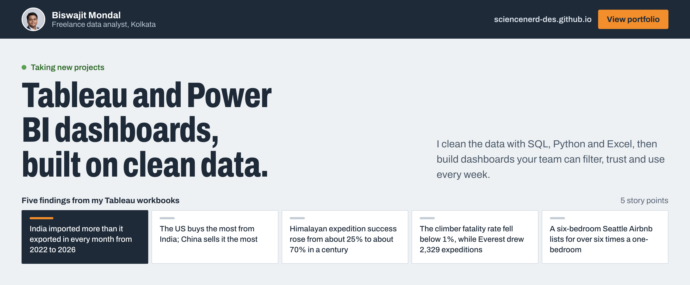
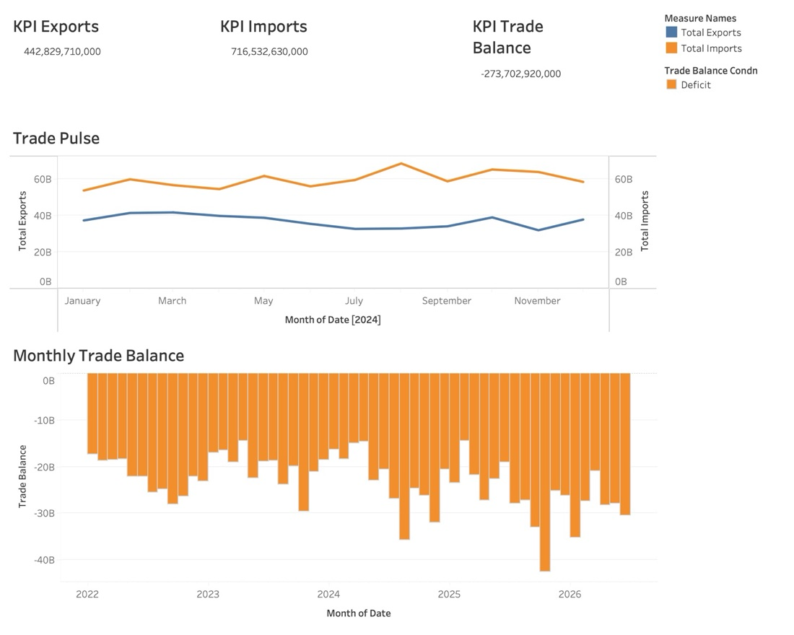
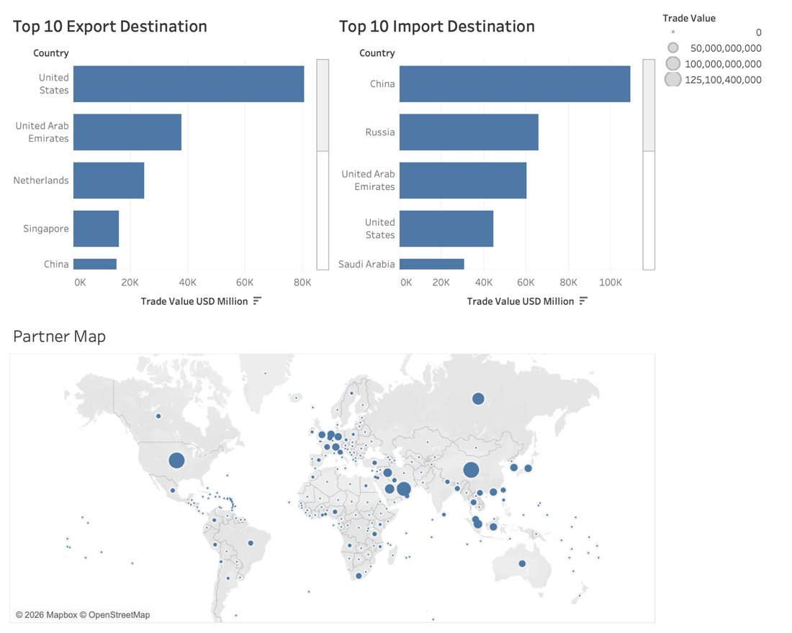
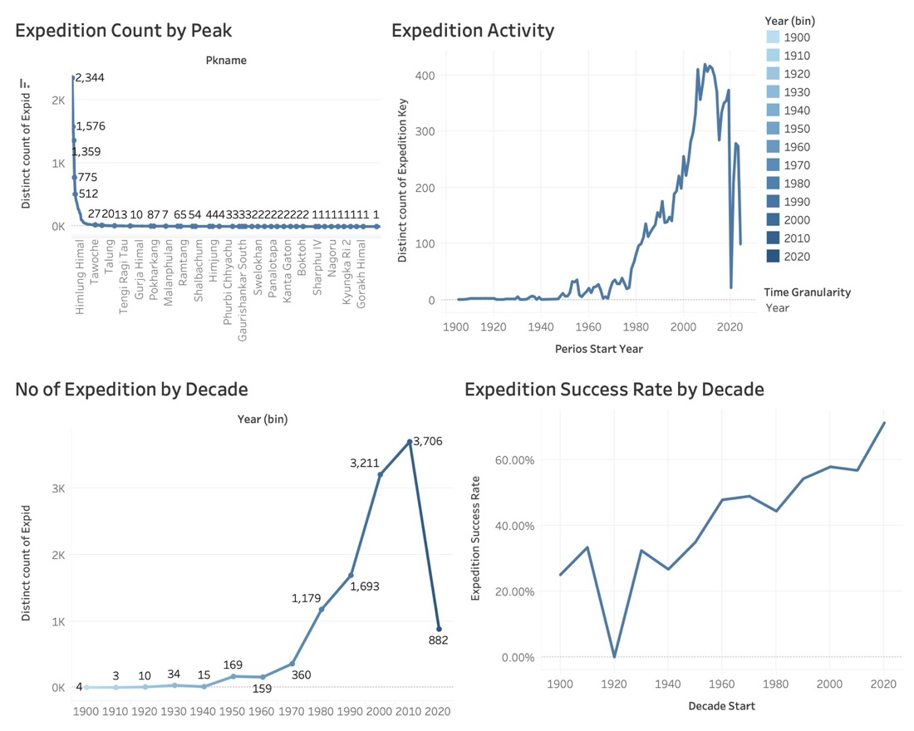
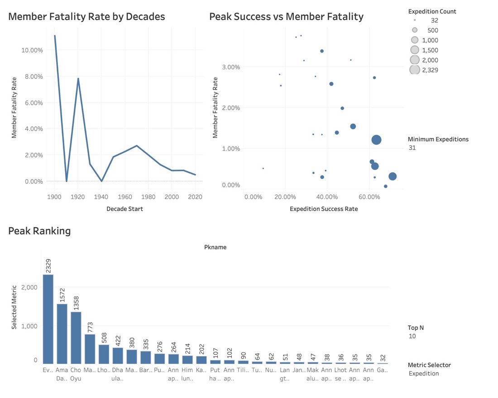
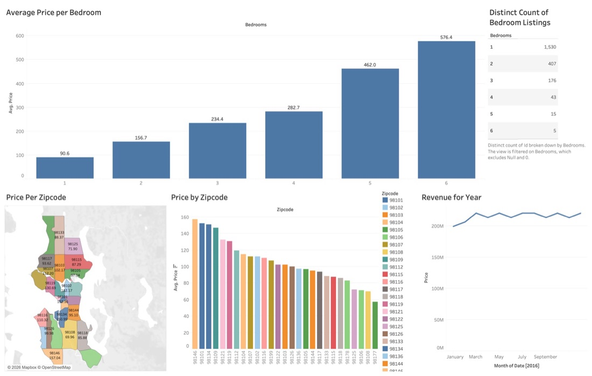
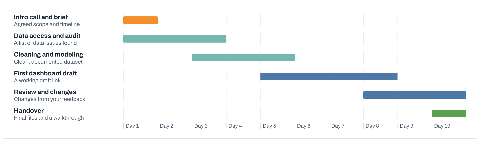

<a href="https://sciencenerd-des.github.io/">
  <picture>
    <source media="(prefers-color-scheme: dark)" srcset="assets/header-dark.png">
    
  </picture>
</a>

**[View the portfolio](https://sciencenerd-des.github.io/)** &nbsp;&nbsp; **[Email me about a project](mailto:bmondal0000@gmail.com?subject=Project%20enquiry)**

## Building and explaining reliable AI workflows

Alongside data analysis, I build tools for practical AI engineering and use
Codex in my development workflow. These are selected examples to inspect:

| Project | What to explore |
| --- | --- |
| [Forge](https://github.com/sciencenerd-des/forge) | Coding-agent contracts, independent checks, and regressions for false completion |
| [Bharat Doc Intelligence](https://github.com/sciencenerd-des/openai-ai-deployment-portfolio) | Structured document extraction separated from deterministic validation; mock results are labelled |
| [Technical writing](https://github.com/sciencenerd-des/writing) | Reproducible lessons, engineering decisions, and limits of the evidence |

My focus is helping builders move from a promising AI-generated result to
something they can explain and verify. These are personal projects; they do
not imply affiliation with or endorsement by OpenAI.

## Five findings from my Tableau workbooks

Each story point is a dashboard I built in Tableau Desktop from a public dataset. Click a dashboard to open it at full size.

<table>
  <tr>
    <td width="55%" valign="top"></td>
    <td valign="top">
      India trade workbook, dashboard 1 of 2 
      <b>India imported more than it exported in every month from 2022 to 2026</b>  
      <b>&minus;$274B</b> 2024 balance: $443B exports, $717B imports  
      KPI tiles, a dual-axis line of monthly exports and imports, and monthly balance bars.
    </td>
  </tr>
  <tr>
    <td valign="top"></td>
    <td valign="top">
      India trade workbook, dashboard 2 of 2 
      <b>The US buys the most from India; China sells it the most</b>  
      <b>US</b> top export market, about $80B 
      <b>China</b> top import source, over $100B  
      Top 10 partner rankings and a proportional-symbol world map.
    </td>
  </tr>
  <tr>
    <td valign="top"></td>
    <td valign="top">
      Himalayan expeditions workbook, dashboard 1 of 2 
      <b>Himalayan expedition success rose from about 25% to about 70% in a century</b>  
      <b>3,706</b> expeditions in the 2010s, the busiest decade  
      Joins expeditions, members and peaks tables; time-granularity parameter.
    </td>
  </tr>
  <tr>
    <td valign="top"></td>
    <td valign="top">
      Himalayan expeditions workbook, dashboard 2 of 2 
      <b>The climber fatality rate fell below 1%, while Everest drew 2,329 expeditions</b>  
      Success vs fatality scatter sized by expedition count, with Top N, metric and minimum-expedition parameters.
    </td>
  </tr>
  <tr>
    <td valign="top"></td>
    <td valign="top">
      Seattle Airbnb workbook 
      <b>A six-bedroom Seattle Airbnb lists for over six times a one-bedroom</b>  
      <b>$91 to $576</b> average nightly price, 1 to 6 bedrooms 
      <b>1,530</b> one-bedroom listings, the largest group  
      Filled zip-code map, zip codes ranked by price, 2016 revenue trend.
    </td>
  </tr>
</table>

In progress: video game sales by genre and platform, and an e-commerce delivery and reviews analysis.

## What you can hire me for

● main tool &nbsp; ○ also used

| Service | Tableau | Power BI | Excel | SQL | Python | R |
|:--|:-:|:-:|:-:|:-:|:-:|:-:|
| **Interactive dashboards** Dashboards your team can filter and explore | ● | ● | ○ | ○ | | |
| **Data cleaning and prep** Messy exports turned into tidy, documented tables | | | ● | ● | ● | ○ |
| **Reporting automation** Weekly and monthly reports that build themselves | | ○ | ● | ○ | ● | |
| **Statistical analysis and A/B tests** Clear answers on what changed and whether it matters | | | ○ | | ● | ● |
| **Financial and audit analytics** Reconciliations, variance checks, exception reports | ○ | ○ | ● | ● | ○ | |
| **KPI design and data modeling** Metric definitions and models that stay consistent | ● | ● | ○ | ● | | |

## How a dashboard project runs

A typical single dashboard takes about two weeks. You see a working draft by day five.

<picture>
  <source media="(prefers-color-scheme: dark)" srcset="assets/process-dark.png">
  
</picture>

## Code projects

| Project | What it is | Built with |
|:--|:--|:--|
| [Growth analytics dashboard](https://github.com/sciencenerd-des/Resume_Projects/tree/main/Project_1) | Funnel, retention cohorts and CAC vs LTV on a Python star-schema pipeline, with a Power BI model and DAX | Python, Power BI, React |
| [Bharat Doc Intelligence](https://github.com/sciencenerd-des/openai-ai-deployment-portfolio) | Reads Indian GST invoices into validated, structured data and flags anomalies, with a deterministic audit layer and evals | OpenAI Agents SDK, FastAPI |
| [Financial Agents](https://github.com/sciencenerd-des/Financial_Agents) | Event-driven multi-agent workflow with approval gates and a FastAPI gateway | Python, FastAPI, Docker |
| [Task Manager](https://github.com/sciencenerd-des/task-manager) | Kanban app with real-time sync and natural-language task entry | Next.js, Convex, WorkOS |
| [Upwork portfolio](https://github.com/sciencenerd-des/upwork-portfolio) | Report generator, document intelligence service and task manager | Python, Streamlit, FastAPI |

Writing on reliable LLM features lives in [sciencenerd-des/writing](https://github.com/sciencenerd-des/writing).

## Start a project

Email **[bmondal0000@gmail.com](mailto:bmondal0000@gmail.com?subject=Project%20enquiry)**. A good first email covers where your data lives, the questions the dashboard should answer, who will use it, and your deadline.

Kolkata, India (UTC+5:30). Works in English, Hindi and Bengali.
